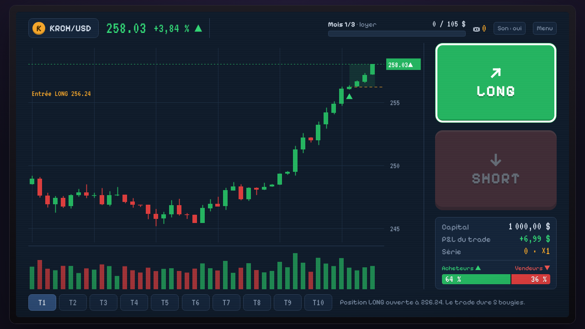

# Krach Test

Roguelike de trading façon Balatro. Tu paies ton loyer en tradant depuis ta chambre : à chaque trade, le marché montre 12 bougies, tu choisis LONG ou SHORT, et les 5 bougies suivantes donnent le résultat. Les retournements ne tombent jamais du ciel : ils sont annoncés par des signes sur le graphique (mèche, volume, jauge acheteurs et vendeurs). Le jeu apprend à les lire.

**Jouer dans le navigateur : https://antoinecayuela.github.io/krach-test/**



> Les entreprises, les prix et les news sont inventés. Le trading réel fait perdre de l'argent à la majorité des particuliers. Ce jeu entraîne à lire un graphique, il ne donne aucun conseil d'investissement.

## Le jeu en bref (base v3)

- Une partie = un palier. Chaque mois (séance) a un loyer à payer : un gain minimum à faire en 10 trades.
- P&L = capital × (sortie / entrée − 1), en positif pour un LONG qui monte ou un SHORT qui baisse. Chaque gain d'affilée monte la série : ×1, ×1,5, ×2… jusqu'à ×3. Une perte remet la série à 0.
- Loyer payé avant la fin : encaisser donne un ticket par trade restant. Loyer raté : un ticket achète un trade bonus (1, puis 2, puis 3 tickets). Sans ticket, le propriétaire envoie un SMS et le palier recommence.
- 5 paliers, une nouveauté par palier : tendances et retournements, range, faux signaux, news surprises, crypto.
- Gros trade (série à ×2 ou trade décisif pour le loyer) : bougies ralenties, battements de cœur, écran qui tremble.
- Après chaque trade, une explication dit ce qu'a fait le marché et la bonne lecture. Chaque terme de trading s'explique dans une bulle à sa première apparition ; le glossaire complet s'ouvre avec G.
- Clavier : ↑ ou L pour LONG, ↓ ou S pour SHORT, Entrée pour le bouton principal.

## Stack et architecture

- Vite + TypeScript strict, sans framework ni dépendance d'exécution. Graphique en Canvas 2D.
- Tests : Vitest pour le moteur, Playwright pour un test de fumée dans un vrai navigateur.
- Hébergement : GitHub Pages, publié par GitHub Actions.

```
src/
  engine/          logique pure, sans DOM, testable dans Node
    rng.ts         générateur pseudo-aléatoire à graine (mulberry32)
    rules.ts       chiffres du GDD : capital, trades par séance, multi de série, trades bonus
    tiers.ts       les 5 paliers : quotas et paramètres du marché
    market.ts      bougies, régimes (hausse, baisse, range), signes, faux signes, news
    run.ts         machine à états d'une partie
    explain.ts     explication après chaque trade
    progress.ts    paliers débloqués et records
  data/            glossaire et news
  ui/              écran de jeu, graphique, sons, sauvegarde
  sim/bot.ts       joueur automatique pour l'équilibrage
scripts/sim.ts     taux de victoire par palier et par taux d'erreur
tests/             tests unitaires (dont l'exemple chiffré du GDD)
e2e/               test de fumée Playwright
```

L'état d'une partie est un objet JSON sauvegardé avant chaque trade : la même graine redonne exactement le même marché.

## Lancer le projet

Il faut Node.js 22.

```bash
npm ci
npm run dev      # jeu sur http://localhost:5173
npm test         # tests unitaires
npm run e2e      # test de fumée (Playwright, Chromium)
npm run sim      # taux de victoire du joueur automatique
npm run build    # vérification TypeScript et build de production dans dist/
```

## Équilibrage

`npm run sim` joue 1 000 parties par case avec un joueur qui lit les signes correctement, sauf une part d'erreurs. Taux de victoire du palier, en % :

| Palier | 0 % d'erreurs | 10 % | 20 % | 30 % |
|---|---|---|---|---|
| 1 | 100 | 97 | 73 | 39 |
| 2 | 100 | 92 | 55 | 16 |
| 3 | 99 | 84 | 39 | 8 |
| 4 | 93 | 67 | 33 | 8 |
| 5 | 84 | 62 | 37 | 13 |

Ces chiffres correspondent au tableau du GDD v3, sans Outils ni Cartes (la boutique arrive dans une prochaine version).

## Déploiement

Le workflow `.github/workflows/deploy.yml` publie le jeu à chaque push sur `main` (source **GitHub Actions** dans **Settings > Pages**). Le workflow `ci.yml` lance le build, les tests et le test de fumée sur chaque pull request.

## Auteur

Game design : Antoine Cayuela, étudiant en BTS SIO (Lyon). Code écrit avec Claude Code à partir du GDD.
