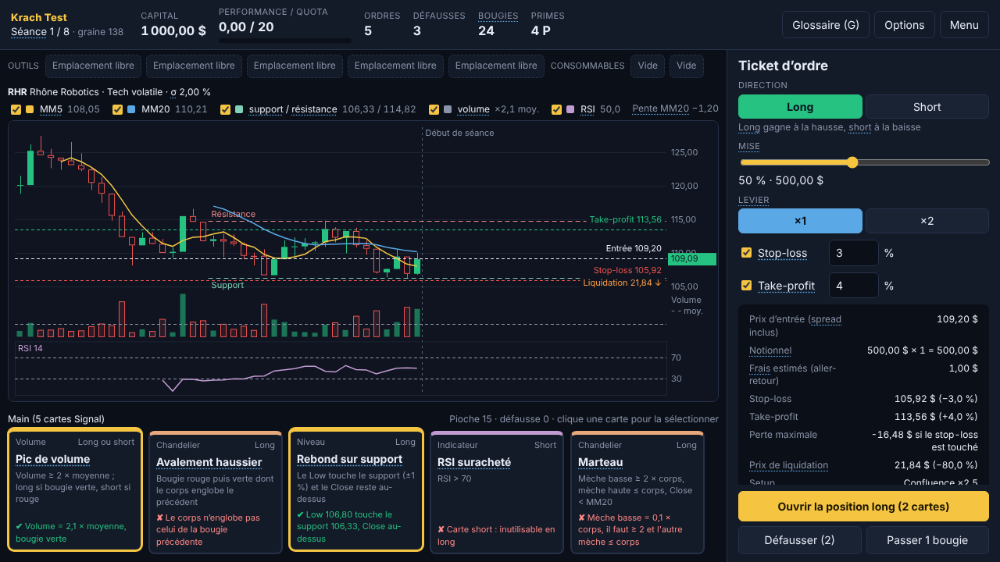
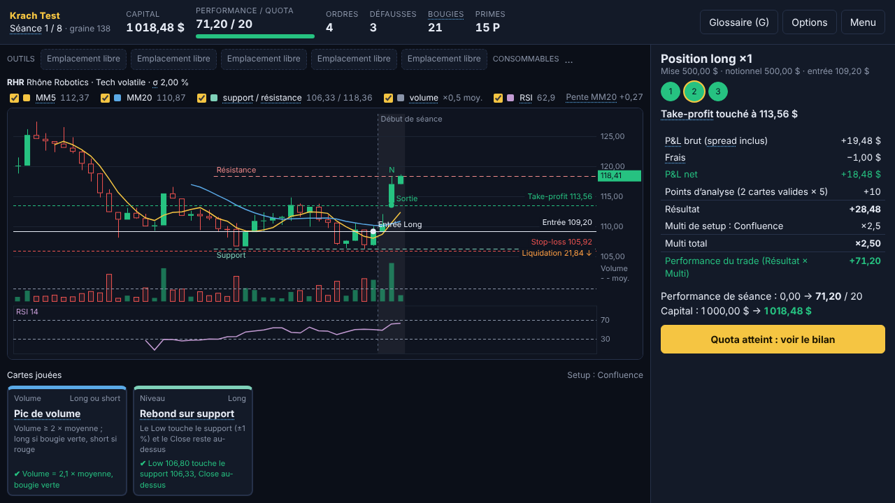

# Krach Test

Roguelike de cartes façon Balatro sur le thème du trading. On lit un graphique en chandeliers, on joue des cartes Signal (marteau, RSI, support, pic de volume…) et on ouvre des positions pour atteindre un quota de Performance à chaque séance. En chemin, le jeu apprend le vocabulaire et les mécanismes des marchés : long et short, levier, stop-loss, spread, liquidation.

**Jouer dans le navigateur : https://antoinecayuela.github.io/krach-test/**





> Les entreprises, les prix et les news sont fictifs. Le trading réel fait perdre de l'argent à la majorité des particuliers. Ce jeu est un entraînement au vocabulaire, pas un conseil d'investissement.

## Le jeu en bref

- Une run, c'est 8 séances. Une sur deux est une séance à événement (marché sans tendance, jour de résultats, frais doublés, volatilité écrasée), et la dernière est un krach.
- Chaque séance donne 5 ordres, 3 défausses et 24 bougies pour atteindre le quota.
- À chaque tour, on choisit long ou short. Chaque carte de la main indique alors ✔ ou ✘ avec la raison (« RSI = 41, il faut < 30 »). Ensuite, on joue 0 à 3 cartes et on règle la mise, le levier, le stop-loss et le take-profit.
- Score : Résultat = 5 × cartes valides + P&L net. La Performance vaut Résultat × Multi si elle est positive, et Résultat × 0,5 si elle est négative. Une confluence de familles différentes vaut plus qu'un signal isolé.
- Le capital est conservé d'une séance à l'autre. Sous 10 $, c'est le margin call.
- Entre deux séances, la boutique vend des Outils (15, avec des synergies) et des consommables (6).
- Chaque terme de trading affiché à l'écran est souligné. À sa première apparition, sa définition s'ouvre. Le glossaire complet s'ouvre avec la touche G.

## Stack et architecture

- Vite + TypeScript strict, sans framework : DOM et CSS natifs. Le graphique est dessiné en Canvas 2D par le code du projet. Le projet n'a aucune dépendance d'exécution.
- Tests : Vitest pour le moteur (100 tests), Playwright pour un test de fumée dans un vrai navigateur.
- Hébergement : GitHub Pages, publié par GitHub Actions.

```
src/
  config.ts        tous les nombres du game design (un seul endroit pour équilibrer)
  engine/          logique pure, sans DOM, entièrement testable
    rng.ts         générateur pseudo-aléatoire à graine (mulberry32)
    market.ts      bougies, régimes cachés (bull, bear, range), news et gaps
    indicators.ts  MM5, MM20, RSI 14, support, résistance, volume moyen, pente
    cards.ts       conditions de validité des 14 cartes Signal
    trade.ts       résolution d'une position : stop-loss, liquidation, take-profit
    scoring.ts     formule de score et multiplicateurs
    run.ts         machine à états de la run et de la séance, Outils, consommables
    shop.ts        boutique
  data/            textes : Outils, consommables, événements, glossaire
  ui/              un module par écran, plus chart.ts (Canvas) et tooltip.ts
  sim/bot.ts       robot naïf pour l'équilibrage
scripts/sim.ts     5 000 runs par construction d'Outils, comparées au GDD
tests/             tests unitaires (dont l'exemple chiffré du GDD rejoué à 1e-6 près)
e2e/               test de fumée Playwright
docs/              game design document, décisions, avancement
```

L'état complet d'une run est un objet JSON. Il se sauvegarde tel quel dans le localStorage, et la même graine redonne exactement les mêmes marchés.

## Lancer le projet

Il faut Node.js 22.

```bash
npm ci
npm run dev      # jeu sur http://localhost:5173
npm test         # tests unitaires
npm run e2e      # test de fumée (Playwright, Chromium)
npm run sim      # simulation d'équilibrage (environ 15 s)
npm run build    # vérification TypeScript et build de production dans dist/
```

## Équilibrage

Les quotas ont été calibrés avec un simulateur (`tools/simulation-python/`), puis vérifiés par `npm run sim`, qui rejoue le même robot naïf en TypeScript. Taux de réussite de chaque séance (en %, sur les runs qui l'atteignent), avec entre parenthèses la valeur du tableau 7.3 du GDD :

| Construction | S1 | S2 | S3 | S4 | S5 | S6 | S7 | S8 |
|---|---|---|---|---|---|---|---|---|
| Aucun Outil | 88 (87) | 79 (77) | 76 (73) | 70 (72) | 48 (43) | 21 (18) | 17 | 31 |
| Synergies + levier | 88 (87) | 79 (78) | 77 (75) | 73 (72) | 74 (70) | 62 (62) | 64 (61) | 67 (65) |

Sans Outil, une run gagne rarement : la boutique est indispensable, comme dans Balatro.

## Déploiement

Le workflow `.github/workflows/deploy.yml` publie le jeu à chaque push sur `main`. Avant le premier déploiement, il faut aller dans **Settings > Pages** et choisir **GitHub Actions** comme source. Le workflow `ci.yml` lance le build, les tests et le test de fumée sur chaque pull request.

## Documentation

- [Game design document](docs/gdd.md) : règles, formules, Outils, glossaire. Il fait autorité.
- [Décisions d'implémentation](docs/DECISIONS.md) : les cas que le GDD ne précise pas, et le choix retenu.
- [Avancement](docs/PROGRESS.md)
- [Prompt de développement](docs/prompt-claude-code.md) : les 8 jalons suivis pour coder le prototype.

## Auteur

Game design : Antoine Cayuela, étudiant en BTS SIO (Lyon). Code écrit avec Claude Code à partir du GDD.
